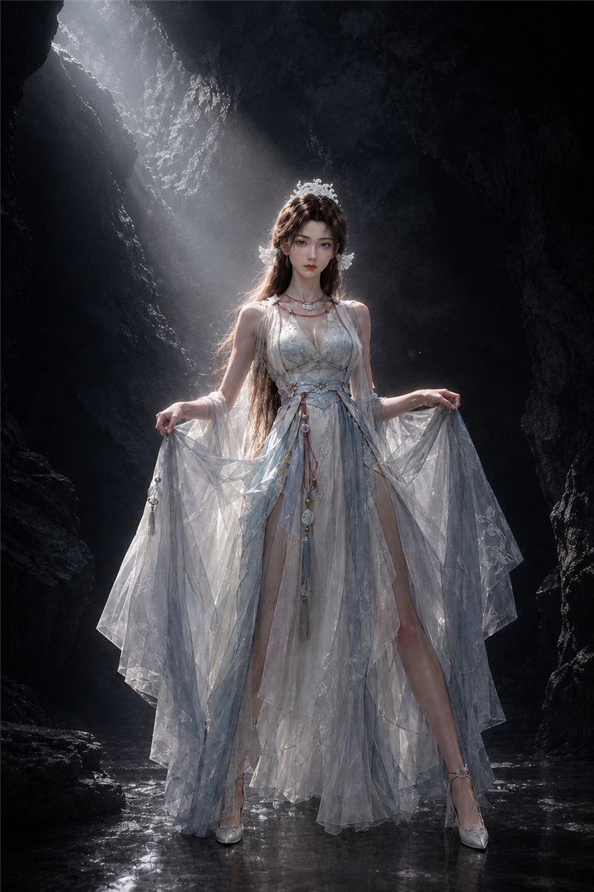

# 025 · H3 古风舞蹈进阶教程：动作链反推、局部特写转场，以及双提示词手动剪辑

> 很多人用 H3 生成古风舞蹈，最后都会遇到一个问题：人物很美、衣袖也会飘，但动作总是云手、转身、抬手、低头，每段都像同一支舞，镜头只是换了角度。真正的解决办法不是继续堆“优雅、灵动、仙气、唯美”，而是从**动作链、时间轴、摄影机、剪辑结构**四个层面重新设计。本篇以《白凤蒙尘》为例。

## 案例信息（Inputs）

| 项 | 内容 |
|---|---|
| 编号 | 025 |
| 类型 | 真人古风舞蹈音乐 MV（多段独立生成 + 第三段双提示词手动剪辑） |
| 输入 | 每段一张 `<Picture 1>`（人物+完整环境唯一视觉权威）+ 该段裁剪 `<Audio 1>` |
| 画幅 | 9:16 竖屏，真人摄影质感、冷中性低饱和 |
| 全曲 | 79.882 s · 105.25 BPM · 六段（第三段实际双生成、手动剪辑） |
| 完整提示词 | 通用模板 + 六段（SEG03 为完整原文一条）+ 手动剪辑时间点流程见 **[prompt.md](prompt.md)** |

## 音乐时间网格

| 项 | 值 |
|---|---|
| 全曲总长 | 79.882 s |
| BPM | 105.25 |
| 单拍 / 半拍 | 0.5701 s / 0.285 s |
| 单小节 / 乐句 | 2.2803 s / 4.5606 s |

## 六段总览（全曲窗口 / 段内时长 / 主动作机制）

| 段 | 全曲窗口 | 时长 | 主动作机制 |
|---|---|---:|---|
| SEG01 白凤凌霜 | 00:00.000–13.166 | 13.166 | 穿掌背转前 → 背身腰圈扫弧 → 半脚尖平衡 → 遮面露眼 → 碎步后踢 |
| SEG02 暗网坠谷 | 13.166–26.958 | 13.792 | 拧倾出胯 → 圆场碎步 → 低位扫弧 → 沉跪即起（转失败被截） |
| SEG03 仙姿蒙尘 | 26.958–39.413 | 12.455 | 交叠前臂螺旋下沉 → 掌心承重低位跪坐 → 甩发露眼 → 坐姿扭转 → 紧凑半转 → 交叉脚制动 → 半跪起身受阻（实际双生成手动剪辑，见第五节） |
| SEG04 强撑仙姿 | 39.413–52.166 | 12.753 | 横向八字臂线 → 半转甩发 → 半脚尖平衡 → 拧倾出胯（仪态重建） |
| SEG05 被迫校正 | 52.166–65.750 | 13.584 | 跪位撩臂起身 → 沉跪即起 → 关节链反向截断 → 起到一半被打断 |
| SEG06 傲骨未折 | 65.750–79.882 | 14.132 | 呼吸提沉 → 背身双臂渐升 → 立圆胸腰展开 → 空手致意 → 冷静终止 |

---

## 一、第一原则：图 1 锁定视觉，Audio 1 驱动运动

本项目只使用两个输入：

- **Picture 1：** 锁定人物身份、脸部、发型、现有服装、饰品、色彩、光线和原有环境。
- **Audio 1：** 提供原始音乐、节奏和动作时间依据。

不要在提示词中重新描写人物长相、服装和背景，否则相当于给模型第二套设计方案，容易让人物和环境漂移。提示词只负责导演三件事：人物如何运动、镜头如何拍摄、动作如何随音乐变化。

歌词不必写入提示词，保留原始音频即可；人物全程不唱歌、不说话、不做口型。舞蹈用身体表现情绪，而不是让模型照着歌词表演哑剧。

## 二、先建立音乐时间轴，再决定动作密度

《白凤蒙尘》参考参数：总长 79.882 s，BPM 105.25，单拍约 0.5701 s，单小节约 2.2803 s，乐句约 4.5606 s，全曲分六个主要段落、每段不超过 15 s。

这组参数不是要求人物每 0.57 s 机械换姿势，而是建立导演的时间网格：强拍适合身体方向转换、重心落点、动作峰值；弱拍可放头部、手指、手腕的微动作；乐句交界适合镜头揭示、遮挡转场和动作状态变化。

动作必须能跨越节拍自然发展。例如一个低位螺旋可以持续数拍，其中仍可出现脚步换重心、掌心落地、肩胯反向、头发延迟扫过等不同事件。节拍是组织运动的骨架，不是把舞蹈切碎的剪刀。

## 三、真正丰富的古风舞蹈，要从资料库中调用现成动链

《舞蹈动链 H3 库》把动作写成可组合的标准单元，每条链都有进入路径、受力过程、动作峰值、惯性延续、回收顺序和明确出态。例如：

- **C16 云手穿掌·背转前：** 背身双臂上扬 → 云手 → 穿掌翻腕 → 盖步 → 背转前 → 双臂交叉下沉收束。
- **C17 撩袖背身涮腰扫弧：** 撩袖转背 → 腰部沿完整圆弧运动 → 手臂沿低位轨迹划过 → 螺旋拧转回到正面。
- **C24 跪落、跪转、贴地扫弧：** 站姿沉气跪落 → 低位旋转 → 沿地面手臂扫弧 → 坐姿与后仰。
- **C28 侧卧到跪姿再起身：** 收腿 → 推地 → 跪撑 → 展胸 → 单膝蹬地，身体从地面逐层恢复站立。

这些不是必须全用，而是从库中挑选，再按人物、音乐、故事重新组合。反推时先问：这条链从什么姿态进入？哪个部位先启动？重心由哪里转到哪里？四肢如何依次传递动力？最高点在哪？如何利用惯性进入下一个动作？只写“旋转、下腰、展袖”，H3 要自行猜测过程；写出受力、路径与结果，模型才有机会生成更丰富的连续运动。

## 四、为什么我提供的宋玉第三段动作更丰富？

第三段对应全曲原始时间窗 **26.958–39.413 s，时长 12.455 s**，不是普通站立古风舞，而由五种身体运动机制构成：

1. 交叉脚步与前臂交叠，带动重心向下旋入；
2. 掌心承重，进入低位坐姿跪身；
3. 一次甩发完成遮挡与眼神揭示；
4. 坐姿中骨盆与胸廓向相反方向扭转；
5. 地面支撑起身，进入半跪、停滞与未完成的恢复。

重点不只是数量多，而是身体高度、支撑点、旋转轴、运动方向和动作质感都在改变。

更值得注意的是**甩发揭眼**：手经过脸部线条但不必真的碰头发；头部从左向右扫过，头发因惯性延迟跟随，最后露出眼睛。摄影机从肩后移到低位正面，让头发自然成为视觉遮挡。一次动作同时承担舞蹈、表情、镜头转场、叙事四种功能，比单纯插入一个眼睛特写更有效。

## 五、第三段：完整原文提示词奉上，实际用「双生成 + 手动剪辑」完成

提示词本体只有一条——就是那支完整的 **12.455 s 原文提示词**（[prompt.md](prompt.md) 原样奉上、直接复制），不要把它拆成两条。它的导演时间轴在动作上可分为两个章节：

- **前半（全曲 26.958–33.916，6.958 s，Shot 1–3）：低位进入与视觉揭示。** 双脚交叉 → 前臂交叠 → 螺旋下沉 → 掌心承重 → 低位跪坐 → 甩发露眼 → 坐姿侧向扭转；强调从站姿进入地面的完整路径，建立局部特写、头发遮挡与镜头揭示。
- **后半（全曲 33.916–39.413，5.497 s，Shot 4–6）：低位反转与恢复受阻。** 支撑脚与掌心重新承重 → 紧凑半转 → 交叉脚落地 → 脚尖制动 → 再次压低 → 半跪起身，身体试图恢复却在最后停住，留下未完成状态；强调旋转后的惯性、低位动作重组与恢复受阻的反差。

这两章不是两支互不相干的舞，而是同一条动作链的前后两部分。实际制作时，因平台单次生成时长受限、且动作机制复杂，以这条原文为唯一导演依据，分两次生成源片，再在剪辑软件里选动作最匹配的画格衔接；最终只截取需要的动作区间。

**手动剪辑点（精确）：全曲 33.916（SEG03 时间轴 6.958），即原文 Shot 3 结束 / Shot 4 开始。** 前半在坐姿扭转收尾（收手、收腿），后半从撑脚、掌心承重起身进入半转。在两源片该点找身体姿态、运动方向、手部轨迹、摄影机运动的共同相位，优先用手/袖/发丝掠过镜头短暂遮挡接缝；音乐不重启、接缝落在气口。完整五步流程见 [prompt.md](prompt.md)。

手动剪辑的关键不是把两段视频简单拼起来，而是找到两段素材在身体姿态、运动方向、手部轨迹和摄影机运动上的共同点。

## 六、段内转场与段间衔接，必须分开设计

**段内：利用局部特写引导视觉。** 同一段音乐内可用手腕、指尖、脚步、肩背、发丝、眼睛等局部特写：掌心触地时镜头短暂贴近手掌，再顺前臂与肩背受力方向抬起；甩发时镜头跟随发丝扫过，眼睛重新出现时完成揭示；转身时先见肩背，再追随旋转方向回到正面。局部特写不是随意插入的装饰，而是让观众知道接下来该看什么。

**段间：必须保持动作连续。** 段落之间不是每次重摆初始姿势——上一段结尾的手腕方向、脚下重心、身体朝向或眼神落点，应成为下一段的动作起点。把两次生成的源片手动拼接时，优先寻找这样的剪辑点：同一只手沿相同方向继续移动；身体转向保持相同趋势；头发或衣袖掠过镜头短暂遮挡接缝；重心正从一个支撑点转到另一个；摄影机正处于横移、下降或追随中。

段内局部特写负责改变观察位置，段间动作匹配负责维持同一舞者持续运动的感觉，两者不可混为一谈。

## 七、摄影机必须参与动作，而不是事后补拍

希区柯克式压迫变焦（Dolly Zoom）可用于坠落、受制、恢复失败等关键时刻，但不应每段都用。其他镜头按动作选择：

- **脚步与落地：** 保持全身构图，让重心变化可读。
- **贴地动作：** 摄影机随身体下降，保留支撑手与伸展腿的关系。
- **甩发揭眼：** 用头发自然遮挡，再落到眼睛。
- **坐姿扭转：** 沿骨盆与胸廓相反方向横移，强化扭转感。
- **旋转急停：** 先随身体转动，再稍迟到并重新找到人物，制造真实惯性。
- **受限起身：** 摄影机随身体升高，但在动作停滞时停止，让“起不来”被看见。

每个镜头都应回答：摄影机在哪里？为什么此刻运动？最后要揭示什么？只写“镜头环绕人物”，即使模型完成运镜，也未必让舞蹈更丰富。

## 八、最后的制作检查清单

提交 H3 提示词前，检查：

- [ ] 人物与环境是否完全由图 1 锁定？
- [ ] 音频是否保持原始状态、没有把歌词写进提示词？
- [ ] 是否明确禁止人物唱歌、说话、对口型？
- [ ] 每段是否拥有真正不同的脚步、重心和身体运动机制？
- [ ] 是否写清动作如何启动、发展、到达峰值、回收？
- [ ] 特写是否引导观众看到关键动作，而不是重复推脸？
- [ ] 每段结尾是否指定可供下一段接续的动作状态？
- [ ] 两次生成的源片是否通过动作匹配完成手动剪辑（剪辑点全曲 33.916）？
- [ ] 旋转、下沉、起身是否具有可信的支撑和惯性？
- [ ] 是否避免六段重复同一种云手、转身、抬手、定格组合？

## 小结

H3 古风舞蹈的质量，不取决于用了多少古风形容词，也不取决于加入多少摄影术语。真正有效的方法，是从成熟动作链中选择素材，按音乐时间轴重新编舞，让每个动作拥有清晰动力来源；再利用特写、遮挡、视差与剪辑，把多个生成片段组织成一条连续的舞蹈。

- **动作链**解决“怎么跳”；
- **时间轴**解决“何时跳”；
- **镜头**解决“观众看见什么”；
- **手动剪辑**解决“不同生成结果如何成为同一支舞”。

这四件事配合，才是可重复使用的 H3 古风 MV 制作流程。

## 完整提示词

- 通用可套用模板（self-contained 骨架）
- 六段完整提示词（人物称呼统一为 **Song Yu / 宋玉**；第三段为完整 **12.455 s 原文一条**，不拆分）
- 第三段双生成手动剪辑时间点流程（五步）
- 段间匹配剪辑逐边界表

**→ [prompt.md](prompt.md)**

---

← 返回 [H3 Prompt Journal 索引](../../README.md)
