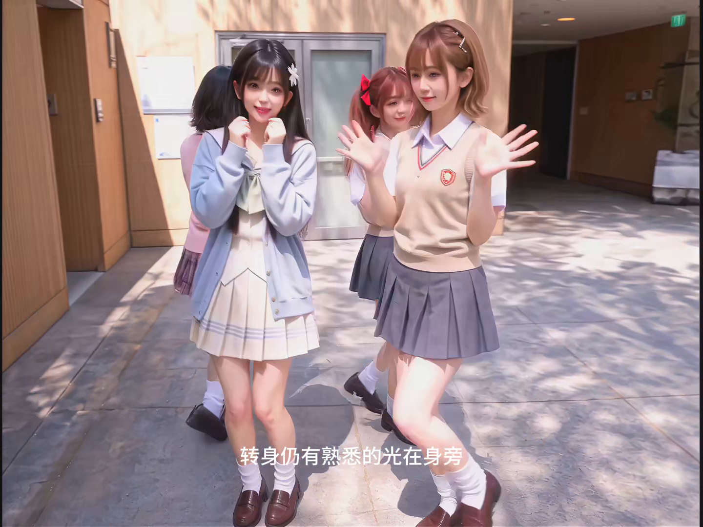

# Case Study — Locking Four Characters Through 181 Seconds of Complex Formation Changes

**A 14-segment dance MV built on one verbatim anchor block, motion-state handoffs, and danced — not walked — formation transitions.**

Demo (Segment 10, exactly as generated from the prompt in this entry):

▶ **[Watch the full Segment 10 demo (13.7s, 1080p)](assets/demo_segment10.mp4)** · Full prompt: [`prompt.md`](./prompt.md) · Journal: [github.com/LoveRain1997/h3-prompt-journal](https://github.com/LoveRain1997/h3-prompt-journal)

More frames from the same segment — layer exchange mid-formation, and the outgoing arm sweep:

| | |
|---|---|
|  |  |

## The problem

Four real-life-rendered characters — Mikoto, Kuroko, Uiharu, Saten — dancing a full
181.56-second song, delivered as **14 consecutive video generations of 10.9–13.9 s each**.
Three failure modes kept killing the multi-segment cut:

1. **Identity drift across segments.** Each generation re-invented the four girls:
   wrong vest emblems, merged hair accessories, costumes quietly redesigned, a fifth
   classmate appearing in the back row. Character A in SEG 03 was not character A in SEG 04.
2. **Formation collapse.** Asked for "2×2 staggered" or "two diagonal pairs," the model
   either walked the dancers into a line (killing the dance), teleported them, or fused
   overlapping legs into an unreadable pile.
3. **Segment seams.** Every cut landed on a static group pose — the clip ended, everyone
   froze for the camera, and the next segment restarted from a neutral stance. The MV
   felt like a slideshow of posed photos.

## The breakthrough: one verbatim anchor, motion-state handoffs, danced transitions

Three mechanisms, in this order of importance:

### 1. The Universal Visual Anchor — written once, pasted verbatim 14 times

The single highest-leverage decision: stop describing the characters per segment.
Instead, ONE English anchor block defines all four subjects by **position in the
reference frame + exact costume inventory**, plus the scene (wood-slat wall, stone
floor, daylight), and ends with a supremacy clause:

> *"<Picture 1> wins on every appearance AND environment question."*

This block is **never translated, never summarized, never shortened** — it is pasted
word-for-word at the top of all 14 prompts. Per-segment prompts then refer only to
`Subject 1 = Mikoto` … `Subject 4 = Saten`. The model stops re-guessing identities
because it is never asked to re-describe them. After this change, identity drift
dropped to near zero; the residual drift (a vest emblem's detail) came only from
shots where the emblem was tiny in frame.

The anchor also carries the crucial **POSE LOCK clause**: the reference picture is
*not* a motion template. Only SEG 01 may start from a calm arrangement; every later
segment starts from a written **INCOMING STATE**, already mid-motion.

### 2. Motion-state handoffs — the seam is a written sentence

Each segment ends with an **OUTGOING HOOK** and opens with an **INCOMING STATE**:
a few sentences that freeze-frame the *exact body state at the cut* — foot pressure,
weight placement, torso rotation, arm follow-through, travel direction — and require
the next generation to start there, mid-action. Segment seams stopped being edits and
became continuous choreography. Example handoff, SEG 09 → SEG 10:

> *OUT (SEG 09):* S4 sweeps her arm across the foreground; S1/S2/S3 keep moving behind.
> *IN (SEG 10):* S1 is mid-shoulder-turn; S3 angled inward; S2/S4 crossing the center
> gap with real travel momentum. The camera opens tight on shoulders and widens along
> the crossing.

### 3. Formation changes are danced transitions with a map

Every segment carries a **FORMATION MAP**: opening arrangement → each transition
(anchored to beat numbers, e.g. "around k50–k52 form a compact staggered 2×2") →
ending arrangement feeding the next segment. Three rules make formations survive generation:

- **Feet lead.** "The supporting foot pivots first; knees and torso follow; the head
  turns last." This one sentence kills the "walk to new spots" failure.
- **Own quadrant only.** Dancers adjust within their lane — half-steps, never walks;
  no center-line crossing, no passing in front of another body.
- **Cut, don't retreat.** New formations are revealed by a cut to a pre-positioned
  close camera, because a retreating camera converts choreography into a wide shot
  where the dance disappears.

## The named language

> **Anchor-Locked Formation Journey** — one verbatim identity anchor + per-segment
> formation maps + motion-state handoffs, on a fixed BPM beat grid (93.75 BPM,
> 0.640 s/beat, k-labels from a cut manifest).

Naming mattered, as it did in the orbital-long-take case: once the prompt contained
the named pattern, the model treated identity, spacing and seam-continuity as three
separate solvable constraints instead of one vague "keep them consistent."

## The consolidated 14-segment set

All timings from the song manifest (total 181.560 s, BPM 93.75). "Final source"
names the authoritative version after consolidating three editing passes
(Rev4.0 base timeline → Rev4.2 personality/formation rewrite of six segments →
Kankan-legwork final rewrites of SEG 03/13/14):

| SEG | Global time | Dur | Formation journey | Final source |
|---|---|---|---|---|
| 01 | 0.000–13.193 | 13.193 | Wind intro → first shared groove | Rev4.0 |
| 02 | 13.193–25.333 | 12.140 | Two partner pairs → shallow V | Rev4.2 |
| 03 | 25.333–36.300 | 10.967 | Shallow V → diagonal pairs → 2×2 staggered | Final Kankan-legwork EN |
| 04 | 36.300–49.366 | 13.066 | Back-turn relight → fast outer arc | Rev4.0 |
| 05 | 49.366–63.216 | 13.850 | Coin flash → fall becomes the opening | Rev4.0 |
| 06 | 63.216–77.066 | 13.850 | Compact four-corner → shallow-V hero | Rev4.2 |
| 07 | 77.066–89.793 | 12.727 | Diamond → shallow V, chasing the sunset | Rev4.2 |
| 08 | 89.793–101.416 | 11.623 | Instrumental burst: dual zones, shallow diamond | Rev4.2 |
| 09 | 101.416–114.966 | 13.550 | Three deliberate formation changes | Rev4.2 |
| **10** | **114.966–128.733** | **13.767** | **Protection arcs → center meet → layer swap → starburst (this entry)** | **This entry, full EN** |
| 11 | 128.733–142.416 | 13.683 | One fall, four-subject relay rise | Rev4.0 |
| 12 | 142.416–156.133 | 13.717 | Climax: fast full-circle outer orbit | Rev4.0 |
| 13 | 156.133–169.313 | 13.180 | Diagonal crossing lines, camera rises through | Final Kankan-legwork |
| 14 | 169.313–181.560 | 12.247 | Final push → four-line flower → held end pose | Final Kankan-legwork EN |

Every segment shares: the verbatim anchor (Section 1 of [`prompt.md`](./prompt.md)),
the beat grid, the lyric-window rule (emotion and phrasing only — never mime the
lyrics, never render their objects), and the same prohibited-defaults list.

## Worked example: SEG 10 — the formation round trip

SEG 10 was chosen as the reference implementation because it exercises every
mechanism at once: two protection arcs that cross through each other's space
without collision, a center meet, a front/back layer swap, a rotation relay, and a
four-line starburst — 22 written beats in 13.767 seconds, each beat one continuous
action cell, each camera move bound to the same beat it covers.

The full prompt is in [`prompt.md`](./prompt.md). Structure, in order:

1. Universal anchor (verbatim)
2. Format + audio slice + BPM grid
3. Identity anchors + incoming motion state
4. Choreography style + lyric windows
5. Four movement personalities
6. Camera geometry (six shots, each tied to a beat range)
7. Formation map (in → arcs → meet → swap → starburst → out)
8. Exact 22-beat timeline
9. Camera & continuity absolutes
10. Audio fields

The demo video at the top of this page is the direct generation from this prompt.

## 48-hour takeaways

- **Identity is a paste, not a description.** Write the anchor once; forbid yourself
  from ever re-wording it. The moment a prompt "helpfully" re-describes a character,
  the model starts re-designing her.
- **Seams are content.** Write the cut-frame body state as carefully as any dance beat;
  the segment boundary is where multi-segment MVs die.
- **Formations must be danced.** Feet lead, own quadrant only, cut instead of retreat —
  three sentences that separate "formation change" from "four people walking."
- **Lyrics direct emotion, never imagery.** The moment lyrics become objects on screen,
  the film starts hallucinating props the anchor never allowed.

## Files

- [`prompt.md`](./prompt.md) — full SEG 10 prompt (worked example, English)
- `assets/demo_segment10.mp4` — generated demo for SEG 10
- `assets/frame_*.png` — stills from the demo

Part of the [H3 Prompt Journal](https://github.com/LoveRain1997/h3-prompt-journal) ·
Repo: <https://github.com/LoveRain1997/h3-prompt-journal>
