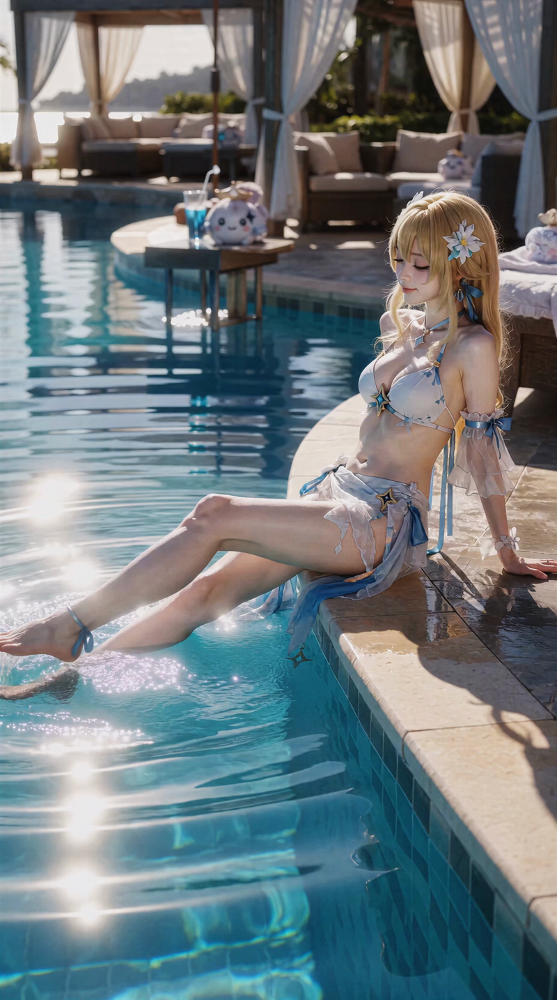

# 024 · MiniMax H3 实战教程：用 4 段提示词，设计一支 55 秒真人夏日 MV

> 一个人物、一张参考图、一首歌，拆成四个独立生成片段（泳池、海滩奔跑、贴地仰拍、水面泡沫遮挡）。核心不是堆叠“电影感、写实、运镜丰富”，而是把**人物身份、身体动作、摄影机位置、构图几何关系、镜头切换**分别写清楚。

## 案例信息（Inputs）

| 项 | 内容 |
|---|---|
| 编号 | 024 |
| 类型 | 真人摄影质感 · 夏日生活方式音乐 MV（多段独立生成） |
| 输入 | 每段一张人物参考图 `<Picture 1>` + 该段裁剪音频 `<Audio 1>`（四段都重传同一张图） |
| 画幅 | **9:16 竖屏**，统一冷中性、低饱和、真人摄影质感 |
| 总时长 | **55 秒**（10 + 15 + 15 + 15） |
| 段数 | 4 个独立任务，共 8 个镜头、4 处硬切（含第三段 1 处、第四段 0 处） |
| 完整提示词 | 四段可直接复制的英文提示词见同目录 **[prompt.md](prompt.md)** |

## 四段时间线总表（已校正，local time = 段内时间）

| 段 | 时长 | 全曲音频窗口 | 段内镜头 | 硬切位置（local） |
|---|---:|---|---|---|
| Part 1 | 10 s | 00:00–00:10 | 泳池坐姿 → 高位倾斜海滩奔跑 | 00:05.000（1 个） |
| Part 2 | 15 s | 00:10–00:25 | 漂浮特写 → 浅水背后跟拍 → 擦头发 | 00:05.000、00:10.000（2 个） |
| Part 3 | 15 s | 00:25–00:40 | 固定贴地仰拍 → 站姿/浅水（连续） | **00:03.000（全段唯一硬切）**；00:08 不切 |
| Part 4 | 15 s | 00:40–00:55 | 浴缸水线 + 泡沫前景遮挡 | 无硬切（一镜到底，00:05/00:10 为连续阶段） |

---

## 一、先建立正确的参考图工作流

每段生成时，只需要提供：

- **Picture 1：** 人物身份与外观参考。
- **Audio 1：** 当前片段对应的音乐。

其中最重要的一点是：参考图负责锁定人物，不代表必须复制参考图里的姿势、背景和摄影机角度。

提示词中明确区分两类信息：

- **需要保留的内容：** 脸型、五官比例、肤色、发型、发色、身体比例，以及服装的可识别特征。
- **需要重新设计的内容：** 场景、身体姿势、摄影机机位、取景范围、运镜路径和镜头之间的剪辑关系。

如果希望多个独立生成的片段仍然是同一个人，每一段都应重新上传同一张人物参考图，并重复强调身份一致性。只在第一段提示词中写身份锁定，不足以保证后续独立生成自动继承人物外观。

## 二、第一段：泳池坐姿 → 高位倾斜海滩奔跑（10 秒）

目标：用两个完整镜头建立夏日 MV 的视觉风格。

**00:00–00:05｜泳池边坐姿**
人物坐在泳池边，双手支撑身体，腿部一伸一屈，伸出的脚轻轻触碰水面，制造自然涟漪。摄影机从池边前侧稍高于人物髋部的位置拍摄，缓慢横向移动。人物、伸出的腿、泳池边缘与水面共同构成画面中的斜向线条。

**00:05.000｜硬切（本段唯一切点）**
由伸出腿的斜向方向和泳池边缘的后退线引导，做一次干净的硬切。

**00:05–00:10｜高位倾斜海滩奔跑**
转换到高位斜俯视的海滩跟拍。人物沿湿沙与浅海水的边界持续奔跑，轻薄衣料和头发随运动与海风摆动。

这里的关键经验是：**倾斜构图不等于简单地把摄影机歪一下。** 需要同时描述摄影机的高位斜俯角、画面滚转、海岸线的对角方向、人物在画面中的斜向位置，以及连续跟随人物的运镜。即使地平线没有出现，海岸线和浪线也能建立强烈的倾斜视觉感。人物自身的跑步姿态仍须符合正常重力与人体运动规律，不能为了模拟画面倾斜而扭曲身体。

## 三、第二段：漂浮特写 → 浅水背后跟拍 → 擦头发（15 秒）

目标：用三个不同机位表现同一个人，同时维持人物身份和动作连续性。

**00:00–00:05｜水面漂浮（00:05.000 硬切）**
人物仰面漂浮，头部位于画面右侧，身体向左延伸。摄影机接近水面，从人物侧方平行缓慢滑动。人物随水流轻微起伏，头发自然铺展在水面上。镜头重点表现脸部、肩线、湿发、水波和空间层次，而不是从高处俯拍整个身体。

**00:05–00:10｜浅水奔跑背后跟拍（00:10.000 硬切）**
切换到人物后方，摄影机保持腰胯附近的高度并稍微向下看。人物背对镜头在浅水中自然奔跑，腿部交替迈步，脚步激起小范围水花。摄影机从后侧三分之四角度逐渐调整到更直接的正后方视角，但这是同一镜头里的连续运动，不是额外插入机位。

**00:10–00:15｜斜上方擦头发**
再次硬切到泳池边，人物坐在躺椅上，双手用毛巾擦拭湿发。摄影机从前侧斜上方约 30–45 度拍摄，让头部、毛巾、双手、肩膀、弯曲的膝盖和椅子同时入画。要特别描述手与毛巾之间持续、合理的接触，以及毛巾随挤压形成的真实褶皱——否则模型容易出现手已经离开毛巾、擦头发动作却仍在继续的情况。

身份一致性是这一段的核心：背面镜头虽然看不清五官，但发型、发色、身体比例和服装特征仍须一致。

## 四、第三段：固定贴地仰拍 → 起身 → 硬切到新场景（15 秒）

目标：让一个极特殊的 POV 机位成为开场，再自然过渡到常规 MV 运镜。**本段只有一个硬切，时间点精确落在 00:03.000；00:08 不是切点。**

**00:00–00:03.000｜Fixed Floor-Level POV**
摄影机光学中心距离地面仅几厘米，镜头轴线垂直向上、直指天花板。人物仍坐在椅子上延续擦头发动作，弯曲的双腿在近景中形成自然弧线，脸从腿部轮廓之间显露，未被遮挡处可见天花板。这个镜头必须明确：摄影机是固定、不可见的 POV 视角，而不是会出现在画面里的另一台设备。

**00:03.000｜结束动作并硬切（全段唯一硬切）**
人物自然完成最后一次擦发、放下毛巾、身体前倾并起身。摄影机不追随人物站起，继续留在原地，随后在 **00:03.000** 执行明确硬切。

**00:03.000–00:08｜泳池边站姿（同一连续镜头的前半）**
切到新的泳池或海边场景，人物站在水边，以三分之四侧身姿态轻转水面、再回头看镜头；摄影机在侧前方平缓横向移动。

**00:08–00:15｜浅水动作与回身（同一连续镜头的后半，不切）**
约在 **00:08**，摄影机**在同一个镜头内**开始后退跟拍，人物走向浅水、迈步、微转躯干、伸手维持平衡，然后回望镜头，停在放松的三分之四站姿。从横向跟拍到后退跟拍是一次连贯的运镜转换，**不是第二次硬切**。

这一段的重点是镜头语言切换：开场依靠固定机位和身体遮挡建立冲击，后续通过常规跟拍、人物转身和水面空间恢复流动感。

## 五、第四段：浴缸水线视角 + 前景泡沫遮挡（15 秒）

目标：把水面本身变成镜头语言，而非反复切换正面、侧面和俯拍。**整段一镜到底，00:05 与 00:10 只是同一镜头内的连续推进阶段，不是切点。**

这段借鉴浴缸写真式的泡沫构图，但继续使用整套 MV 的低饱和、冷中性色彩与真人摄影质感，而不是暖黄、奶油色的浴室广告风格。

**00:00–00:05｜建立水线与人物轮廓**
摄影机位于浴缸前端、贴近水面，约一半画面在水上、一半在水下。靠近镜头的白色泡沫形成虚化前景，人物起初被部分遮挡；随摄影机缓慢前移，脸部与湿发逐渐显露。

**00:05–00:10｜穿过泡沫靠近人物（连续，不切）**
摄影机继续沿同一方向前进，从泡沫簇之间的自然缝隙穿过。人物缓慢转头看向镜头，轻理脸侧一缕湿发。泡沫负责前景层次，水线负责空间关系，脸部保持主要视觉焦点。镜头不能突然跃出水面，也不能切换成常规正面机位。

**00:10–00:15｜水线低角度人像收尾（连续，不切）**
摄影机轻微向上调整角度，但仍贴在水面。人物先向下看向镜头，再自然抬眼，最后停在安静的近距离水线人像。整段不使用闪屏、频繁切镜或突然拉远。

关键不是让泡沫完全挡住人物，而是通过近景虚化、局部遮挡和缓慢移动，让人物逐步显现，同时保留清晰可信的脸部细节。

## 六、这套 H3 提示词最值得复用的五个技巧

1. **把“人物身份”和“场景重建”分开写。** 明确 Picture 1 的保留范围，避免模型把参考图中的原姿势、背景和机位也一起复制。
2. **用具体身体动作代替情绪形容词。** 与其写“优雅地奔跑”，不如写清躯干前倾、腿部交替、手臂反向摆动、脚步落地和衣料滞后运动。
3. **用摄影机几何关系描述特殊视角。** 高位斜俯拍、固定贴地垂直仰拍、半水上半水下的水线机位，都需要说明镜头高度、光轴方向、人物位置和背景关系。
4. **让每个镜头只有一个主要运镜逻辑。** 横向滑动、连续后跟、固定机位、沿水面前推各司其职，不要在同一镜头里堆叠无关的旋转、缩放、俯仰和突然变焦。
5. **把镜头切换与镜头内部运动分开写。** “硬切”负责改变镜头，“连续跟踪”负责描述镜头内部运动；明确区分两者，可减少模型在一个镜头里突然跳到另一机位的问题。

## 七、实际生成建议

四段提示词应作为**四个独立任务**使用，不要合并成一个超长任务。每段都重新提供同一张人物参考图 `<Picture 1>`，并使用对应窗口的 `<Audio 1>`，音乐跨段连续、不重启：

- 第一段使用源音频 **00:00–00:10**；
- 第二段使用源音频 **00:10–00:25**；
- 第三段使用源音频 **00:25–00:40**（段内 local 00:00 = 源 00:25）；
- 第四段使用源音频 **00:40–00:55**（段内 local 00:00 = 源 00:40）。

完成后再检查各片段的脸部身份、服装、发型、色彩、动作连续性和硬切位置。若独立生成的片段出现身份漂移，应优先加强身份锚点，而不是继续增加场景形容词。

需要注意：提示词只能提高模型遵循这些设计的概率，无法保证每次生成都得到完全一致的脸部、精确到帧的切点或百分之百正确的身体动作，实际输出仍需检查和筛选。

**总结：** 好的 H3 提示词，不是写得越华丽越好，而是把人物、动作、机位、构图、光线与时间结构写成一套模型能够执行的拍摄方案。

## 完整提示词

四段可直接复制的完整英文 H3 提示词（含 `<Picture 1>` / `<Audio 1>`、画幅、时长、源音频窗口与逐段时间轴）：

**→ [prompt.md](prompt.md)**

## 标签

`#AIArt #AIVideo #提示词分析 #promptshare #MINIMAXH3 #ai教程`

---

← 返回 [H3 Prompt Journal 索引](../../README.md)
