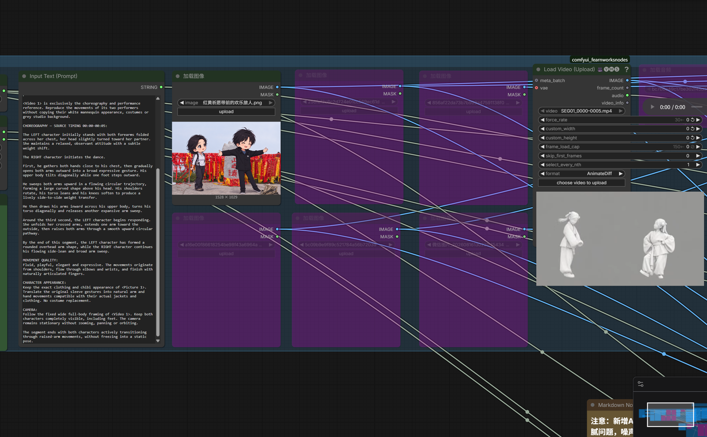

# 动作迁移完整教程：反推拆解 → 时间轴切片 → ComfyUI 工作流出片

> 一份可照做的双人动作迁移流水线教程：先用反推 skill 把参考视频拆成带时间轴的分段 H3 提示词，再按反推出的乐句边界把参考视频切成段，最后在 ComfyUI 工作流里上传人物参考图与分段动作视频、设置时长和分辨率，逐段生成并拼回成片。本教程以《天下第一好》双人 Q 版旅人为实测案例：白模舞参考只提供动作，人物与山野祈愿带场景全部锁定自参考图。
>
> - 参考动作视频：[`reference-motion-white-model.mp4`](./reference-motion-white-model.mp4)（原片 `天下第一好-白模动作参考素材.mp4`，1920×1080 · 30fps · 21.30s）
> - 人物/环境参考图：[`picture-1-travelers-prayer-ribbons.png`](./picture-1-travelers-prayer-ribbons.png)（原图 `红黄祈愿带前的欢乐旅人.png`，1528×1029 · Q 版双人）
> - 工作流接线对照：[`screenshot-20261127-001327.png`](./screenshot-20261127-001327.png)（ComfyUI 画布截图）
> - 配套文件：[`comfyui-workflow.json`](./comfyui-workflow.json)（本教程复制的工作流）· [`reference-skill-reconstruction.md`](./reference-skill-reconstruction.md)（反推 skill 全文）· [`example-reverse-output.md`](./example-reverse-output.md)（本案例反推成品提示词）

---

## 一、这条流水线解决什么问题

动作迁移最常见的翻车方式有三种：把参考视频里的白模脸、灰棚背景、古装一起搬进成片；让两个人从开头就同步跳，丢掉原片「一人领舞、一人延迟加入」的编排；把 21 秒压成一条提示词一次生成，结果动作漂移、身份崩坏、尾部截断。

本教程的流水线把任务拆成四个互相独立的环节，每一环只负责一条信息通道：

```text
① 反推 skill 学习        ② 时间轴提取 + 视频切片        ③ ComfyUI 工作流装配         ④ 逐段生成 → 校验 → 拼接
白模视频 → 拆解表 + 分段提示词   按乐句边界切成 SEG01–04 段片   传图 / 传段片 / 设时长分辨率   每段独立出片，后期按原时间轴拼回
```

参考权限严格分权：

| 参考 | 只管什么 | 不准带过来什么 |
|---|---|---|
| `<Picture 1>`（人物参考图） | 两个人物身份、脸、发型、Q 版比例、服装、背包，以及完整写实户外场景（祈愿带、石碑、栏杆、地面） | —— |
| `<Video 1>`（白模动作视频） | 舞蹈动作、动作时间、人物互动、身体运动轨迹、镜头行为 | 白模外观、灰色棚景、古装、配饰一律不继承 |

> 纪律前提：本教程记录的是**操作流程与提示词规范**，不代替模型直接执行反推或切割；实际跑片时按各环节的脚本/节点操作即可。

## 二、素材清单（本教程实测案例）

| 文件 | 角色 | 规格 | 在提示词中的身份 |
|---|---|---|---|
| [`reference-motion-white-model.mp4`](./reference-motion-white-model.mp4) | 动作参考 | 1920×1080 · 30fps · h264+aac · 21.30s | `<Video 1>`，动作/时序/互动/镜头唯一权威 |
| [`picture-1-travelers-prayer-ribbons.png`](./picture-1-travelers-prayer-ribbons.png) | 人物 + 环境参考 | 1528×1029 | `<Picture 1>`，人物身份、服装、场景全锁 |
| [`screenshot-20261127-001327.png`](./screenshot-20261127-001327.png) | 工作流接线截图 | 2390×1480 | 上传槽位、视频参数、提示词面板的对照参照 |

人物对应关系（身份映射，全程不互换）：

- 白模左侧人物 → 图 1 左侧女生：白上衣、深色长裤、背包；
- 白模右侧人物 → 图 1 右侧男生：黑色外套、蓝色内搭、深色长裤。


*图 1：`<Picture 1>` 人物与环境参考（左女右男；祈愿带、石碑、栏杆、地面全部以本图为准）*

## 三、第 1 步：让 AI 学习反推 skill，拆解参考视频

### 3.1 喂入反推 skill

把 [`reference-skill-reconstruction.md`](./reference-skill-reconstruction.md)（H3 舞蹈视频反推 skill 全文）作为工作规范交给 AI，再上传白模参考视频。skill 的核心纪律：

1. **观察先于写作**：先通看全片，再在动作变化、转身、交叉、重音、段界附近加密抽帧；看不清的动作只描述有证据支持的部分，标注存疑，不脑补肢体路径。
2. **保留原编舞**：动作顺序、时机、方向、脚位、手势路径、互动、队形、结尾都以源片为准；不许把复杂短语简化成「挥手、转圈、跳舞」，也不许补源片没有的跳跃、旋转、道具、表情戏和运镜。
3. **参考分权**：按上表把 Picture / Video / Audio 的权限写死；白模、棚景、古装只是动作参考。
4. **身份映射稳定**：左转左、右转右，转身、重叠、换位途中身份不互换；人数多于参考可识别人数时，明确标注未决映射，不硬凑。
5. **H3 原生语法**：引用标签用尖括号加空格写法——`<Picture 1>`、`<Video 1>`、`<Audio 1>`、`<Subject 1>`，不写 `Picture1` / `Video1`。

### 3.2 反推产出物

反推完成后应拿到两份东西：

- **带时间戳的动作拆解表**（左/右/双人关系/镜头分列）；
- **每段独立可用的 H3 分段提示词**：每段重复参考层级、人物映射、外观与环境锁定、镜头规则，不依赖上一段提示词存在于上下文。

本案例的拆解表（取自 [`example-reverse-output.md`](./example-reverse-output.md)）：

| 时间 | 左侧人物 | 右侧人物 | 编舞重点 |
|---|---|---|---|
| 00–03s | 双臂交叠胸前，观察搭档 | 双手靠近胸前，逐渐展开双臂，抬袖、侧倾、举臂 | 右侧独舞 |
| 03–05s | 从胸前交叠逐渐抬臂，向上形成弧线 | 大幅度挥袖、转肩、后仰 | 左侧加入 |
| 05–08s | 双臂举过头顶，打开成水平展臂 | 身体侧倾，双袖交替展开，向搭档回应 | 双人呼应 |
| 08–10s | 抬膝、举臂，转身背向镜头 | 同步抬膝、举臂，转身背向镜头 | 同步起舞 |
| 10–13s | 背向镜头，双臂斜上展开，侧倾移动 | 与左侧同步，展开手臂、摆动身体 | 双人横向律动 |
| 13–16s | 展臂、侧移、交替抬腿 | 同步展臂，配合身体倾斜与抬膝 | 同步袖舞 |
| 16–19s | 转向侧面，踏步后重新展开双臂 | 配合转身、抬腿，逐渐恢复正面 | 双人转向 |
| 19–21.32s | 一侧手臂向上弯曲，形成俏皮姿态 | 手臂收向胸前，屈膝、身体前倾 | 不对称收尾 |

编舞三条不能丢的特点：手臂由胸前收拢 → 肩带 → 肘开 → 手腕袖口延伸，不是单纯上下挥；腿部以踏步、交替抬膝、单脚支撑为主，没有连续大跳；约第 9 秒两人转为背向镜头，是全片最重要的构图分界。

## 四、第 2 步：提取时间轴，用切割 skill 切出分段视频

### 4.1 从反推提示词确定切点

反推提示词里每段的 `SOURCE TIMING [START–END]` 就是切片边界。本案例四段切点：

| 段号 | 源片区间 | 段长 (s) | 主题 | 切片文件名（建议） |
|---|---|---|---|---|
| SEG01 | 00:00.000–00:05.000 | 5.000 | 右侧先导舞 · 左侧准备加入 | `SEG01_0000-0005.mp4` |
| SEG02 | 00:05.000–00:10.000 | 5.000 | 双人呼应 · 同步举臂 · 转身 | `SEG02_0005-0010.mp4` |
| SEG03 | 00:10.000–00:15.000 | 5.000 | 背向镜头 · 双人同步袖舞 · 横向律动 | `SEG03_0010-0015.mp4` |
| SEG04 | 00:15.000–00:21.320 | 6.320 | 转身回正 · 双人跳步 · 俏皮差异化收尾 | `SEG04_0015-0021p32.mp4` |

四段时长求和 21.320s，与源片 21.30s 的尾差按尾帧自然落幅处理；切点落在动作乐句之间，不切在单个动作句中间。

### 4.2 切割 skill 的用法口径

切割环节复用 [audio-lyric-splitter](https://github.com/LoveRain1997/audio-lyric-splitter) 同一套分段纪律：

- 标准场景（有歌词/音乐）：先拿到逐句 SRT 时间轴，再由动态规划选切点，每段 10–15s、绝不切断唱句、切点贴气口与节拍，输出含段内节拍网格与字位的 `cuts_manifest.json`；
- **本案例是动作驱动、无歌词口径**：时间轴来自反推 skill 的动作乐句边界，切点以拆解表为准；切割时仍走同一自检规则——段长落在允许区间、切点不进入动作句开区间、首尾相接不丢帧；
- 切片后逐项核对：每段实测时长、四段求和是否等于源片时长、左右人物动作是否完整、切点处有无被削掉的起手式。

### 4.3 切片自检要点

1. 段片开场体态与上段结尾态衔接得上（局部动作钩子接住，不靠模型凭空续姿势）；
2. SEG01 的「右侧先跳、左侧观察后加入」在切片开头完整保留；
3. SEG03 的背身状态在段首已经成立，不需要段内再转一次；
4. SEG04 的高低错落收尾完整保留，没有被尾截。

## 五、第 3 步：加载 ComfyUI 工作流

### 5.1 工作流文件

本教程复制的工作流：[`comfyui-workflow.json`](./comfyui-workflow.json)（源自日记案例 030「篮球女孩应援舞 MV」，GitHub 原件见文末地址表）。在 ComfyUI 里直接拖入画布即可加载。

### 5.2 节点地图（本教程需要认识/改参数的槽位）

| 节点类型（数量） | 作用 | 本教程是否需要改 |
|---|---|---|
| `LoadImage` ×6 | 人物/环境参考图、续接 guide 图槽位 | 是：主参考槽上传 `<Picture 1>` |
| `VHS_LoadVideo` ×2 | 上传分段动作参考视频（VideoHelperSuite 节点） | 是：当前生成段的段片 |
| `MiniMaxH3ReferenceToVideo` ×2 | 主生成通道（ref2va），挂提示词、分辨率、帧数、参考模式 | 是：提示词、宽高、帧数 |
| `MiniMaxH3AddGuide` ×1 | 续接组：上段末帧喂给下段做 guide | 续接模式下使用 |
| `GetImageRangeFromBatch` ×2 + `ImageAddNoise` | 取批次尾帧、加噪缓解油腻 | 一般不动 |
| `LoadAudio` ×1 / `TrimAudioDuration` ×1 | 音频输入与时长修剪（本案例纯动作迁移可空置） | 按需 |
| `ResolutionSelector` ×1 | 画幅比例与缩放选择 | 是：按成片画幅选比例 |
| `UNETLoader` ×1 | H3 主模型加载 | 否（模型名见下） |
| `LoraLoaderModelOnly` ×1 | turbo 4 步加速 LoRA | 否（权重 1.0） |
| `PrimitiveFloat` ×1 | 片段时长（Duration，秒） | 是：与当前段片时长一致 |
| `PrimitiveStringMultiline` ×1 | 段提示词文本框 | 是：贴当前段英文提示词 |
| `CreateVideo` ×2 / `SaveVideo` ×2 / `VHS_VideoCombine` ×2 | 成片封装、保存与补帧合并 | 一般不动 |

### 5.3 模型与 LoRA 要求

工作流内预置加载项：

- 主模型（`UNETLoader`）：`minimax_h3_fl_ref_hybrid_scheme_a_25-49_bf16.safetensors`
- 加速 LoRA（`LoraLoaderModelOnly`）：`minimax_h3_ref2v_turbo_4step_v0.1_comfyui_bf16.safetensors`，权重 1.0
- 节点依赖：ComfyUI 本体、VideoHelperSuite（VHS 视频加载/合并）、rgthree（Fast Groups Bypasser）；SageAttention 补丁节点按本机环境启用。

> 单段时长纪律：动作迁移单次生成建议控制在 8–9 秒以内；本案例四段为 5.0 / 5.0 / 5.0 / 6.32 秒，均在安全区内，不要把四段合并成一条长视频一次跑。

## 六、第 4 步：上传图片与 video 模块，设置时间和分辨率

对照下图逐项装配（截图中为 SEG01 的接线状态；原图见 [`screenshot-20261127-001327.png`](./screenshot-20261127-001327.png)）：



*图 2：ComfyUI 画布接线对照——左侧为段提示词文本框，中部为主参考图槽位，右侧 `Load Video (Upload)` 上传当前段动作片*

### 6.1 图片槽位（`LoadImage`）

1. 主参考槽上传 `红黄祈愿带前的欢乐旅人.png`——这是 `<Picture 1>`，人物身份、服装、场景全部由它锁定；
2. 其余 `LoadImage` 槽位留空或按续接方案挂入上段导出的末帧 guide 图；不挂 guide 时保持空槽，不要临时塞其他人物图；
3. 确认图片预览里两个人物左右位置与提示词映射一致（左女右男）。

### 6.2 视频槽位（`VHS_LoadVideo`）

把当前要生成的段片上传到视频模块，参数按下表设置（截图状态：`SEG01_0000-0005.mp4`）：

| 参数 | 设置 | 说明 |
|---|---|---|
| `video` | 当前段切片，如 `SEG01_0000-0005.mp4` | 只取动作轨迹与镜头行为 |
| `force_rate` | `30`（0 = 保持源片帧率） | 源片 30fps；与段片一致即可 |
| `force_size` | `Disabled` | 不在视频加载端缩放，分辨率交给生成节点 |
| `custom_width` / `custom_height` | `0` | 关闭自定义宽高 |
| `frame_load_cap` | `150` | 段片帧数上限（5s × 30fps = 150 帧，刚好覆盖） |
| `skip_first_frames` | `0` | 不从段片开头跳帧 |
| `select_every_nth` | `1` | 逐帧读取，不抽稀 |
| `format` | `AnimateDiff` | 工作流默认读取格式 |

### 6.3 时间设置

- `PrimitiveFloat`（Duration）：填当前段时长（SEG01–03 填 `5`，SEG04 填 `6.32`）；
- `MiniMaxH3ReferenceToVideo` 帧数与时长联动：工作流预置 124 帧 @24fps，按本段目标时长换算帧数；
- 有音频口径时，`TrimAudioDuration` 把音频剪到与本段等长；纯动作迁移本段可空置；
- 段片、Duration、生成帧数三者时长必须一致，防止尾帧被截或片尾留黑。

### 6.4 分辨率设置

- `ResolutionSelector`：本案例横屏双人全身构图，选 `16:9 (Widescreen)`；
- `MiniMaxH3ReferenceToVideo` 宽高预置 `1344 × 768`，与 16:9 对应；竖屏项目则切换 9:16 并同步改宽高；
- 人物参考图本身 1528×1029，上传后由生成节点统一缩放到目标画幅，不需要在图片槽位预裁剪。

### 6.5 提示词文本

在 `PrimitiveStringMultiline`（Input Text / Prompt）中粘贴当前段的完整英文提示词（四段成品见 [`example-reverse-output.md`](./example-reverse-output.md) 的 SEG01–SEG04 代码块）。每段提示词必须自包含：参考权限、左右映射、外观环境锁定、本段动作链、镜头约束、段尾交接态，不要只贴「沿用上一段」。

## 七、第 5 步：生成、校验、拼接

1. **逐段生成**：一段一跑，先出 SEG01，确认人物与场景成立后再跑 SEG02–04；续接组（`MiniMaxH3AddGuide`）可选启用——把上段末帧作为下段 guide 图，帧级过渡更紧，但动作主体仍按本段提示词独立设计。
2. **段间衔接**：不靠模型记住上一段姿势；后一段用局部动作钩子（抬起的手、转向的肩、迈出的脚）与上段结尾构图做匹配，接缝落在局部特写/动作进行中。
3. **成片校验清单**（逐条过，任一条不通过就重跑该段）：
   - 两个人物身份稳定，脸/发型/服装/背包没有漂移或互换；
   - 场景仍是图 1 的祈愿带、石碑、栏杆与地面，没有漏进白模灰棚；
   - SEG01 保留「右侧先导、左侧延迟加入」；
   - 第 9 秒前后的背身转向在成片里成立；
   - SEG04 收尾为左抬臂、右下蹲的高低错落姿态，没有被改成同步定格；
   - 没有新增道具、人物、动物、台词口型或镜头运动；
   - 段长达标、首尾帧完整、无穿模与多余肢体。
4. **后期拼接**：按 SEG01→04 原时间轴把四段拼回 21 秒左右成片；音频（如有）沿用源片切片，段间不重启、不拉伸。

## 八、本案例四段提示词索引

| 段号 | 区间 | 提示词位置 |
|---|---|---|
| SEG01 | 00:00–00:05 | [`example-reverse-output.md`](./example-reverse-output.md) · SEG01｜右侧先导舞 · 左侧准备加入 |
| SEG02 | 00:05–00:10 | [`example-reverse-output.md`](./example-reverse-output.md) · SEG02｜双人呼应 · 同步举臂 · 转身 |
| SEG03 | 00:10–00:15 | [`example-reverse-output.md`](./example-reverse-output.md) · SEG03｜背向镜头 · 双人同步袖舞 · 横向律动 |
| SEG04 | 00:15–00:21.32 | [`example-reverse-output.md`](./example-reverse-output.md) · SEG04｜转身回正 · 双人跳步 · 俏皮差异化收尾 |

## 九、常见翻车点

1. **参考泄漏**：白模脸、灰棚、古装被搬进成片 → 提示词里把「Video 1 只迁移动作机制，外观/服装/背景一律不继承」写成显式锁定句。
2. **开局同步**：两人从第一拍就齐跳，丢掉延迟加入 → SEG01 提示词里单独写清左侧前 3 秒的观察姿态与起步时点。
3. **超时一次成型**：21 秒压成一条提示词 → 必须分段，单段不超过 8–9 秒。
4. **身份漂移**：转身/交叉后左右人物换脸换装 → 提示词反复声明「身份附着在原表演者身上，移动到画面另一侧也不互换」。
5. **结尾被同步化**：差异化收尾被模型改成双人一起摆 pose → SEG04 结尾段把两人各自的收势姿态、高低关系分别写死。
6. **动作写成标签**：只剩「优雅、活泼、流畅」这类形容词 → 按准备 → 发起 → 扩展 → 强拍 → 回收 → 衔接的动作链写具体肢体路径与重心转移。

## 十、插件与仓库地址

| 资源 | 地址 | 用途 |
|---|---|---|
| 本教程目录（工作流 + 反推 skill + 成品提示词） | https://github.com/LoveRain1997/h3-prompt-journal/tree/main/case-studies/2026-11-action-motion-transfer-tutorial | 教程配套文件 |
| 日记总库（30+ 篇反推与实测案例） | https://github.com/LoveRain1997/h3-prompt-journal | 案例与提示词归档 |
| 工作流原件（案例 030） | https://github.com/LoveRain1997/h3-prompt-journal/blob/main/case-studies/2026-11-basketball-girl-cheer-dance-mv-4-segment/comfyui-workflow.json | `comfyui-workflow.json` 来源 |
| 视频反推 skill（参考视频 → H3 提示词） | https://github.com/LoveRain1997/video-to-h3-prompt | 第 1 步反推拆解 |
| 分段切割 skill（歌词/动作感知切段 + manifest） | https://github.com/LoveRain1997/audio-lyric-splitter | 第 2 步切片 |
| ComfyUI 本体 | https://github.com/comfyanonymous/ComfyUI | 工作流运行环境 |
| ComfyUI VideoHelperSuite（VHS_LoadVideo / VHS_VideoCombine） | https://github.com/Kosinkadink/ComfyUI-VideoHelperSuite | 视频加载与成片合并节点 |
| MiniMax H3 上游提示词规范 | https://github.com/MiniMax-AI/MiniMax-H3 | 官方语法与能力参考 |

> 工作流节点组合来自 B 站 UP 主「敢抢我神棍名号」的公开 ComfyUI 方案；上述 GitHub 地址为本教程实际使用的开源插件与仓库。
